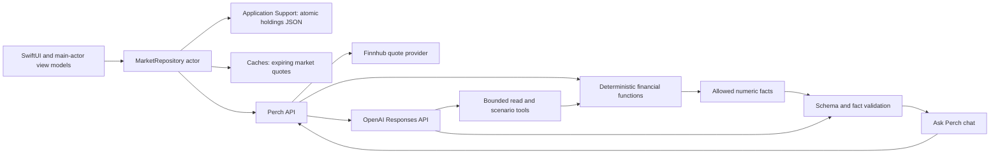

# Project architecture

Perch is a SwiftUI stock tracker, with an iOS app wrapper around the `Perch` Swift package. `PerchApp` creates `PerchRootView`, whose shared `AppContainer` owns a `MarketRepository` actor. Feature view models isolate UI state on the main actor. The original Transactions and Budgets directories contain Watchlist/Discover and Portfolio respectively; the names are retained to preserve Xcode project wiring. The HTML file is an original visual reference, not the shipped app.

## Data flow

The backend is a dependency-free Node service. Native `fetch` calls Finnhub and OpenAI; provider keys exist only in server environment variables. `getPortfolio` is run before every answer; the model can invoke `getPortfolio`, `getStockQuote`, `calculateAllocation`, and `simulateTrade`. Tool selection uses one bounded planning pass and at most eight requested tools. All tools read the supplied snapshot independently, so an extra planning call after a successful tool is unnecessary. These tools never place orders or change holdings. Unknown tools and symbols outside the submitted holdings/watchlist are rejected.

## Financial semantics

- USD, long-only manually entered equities. No brokerage connection, cash ledger, dividends, foreign exchange, corporate action history, or transaction history. Up to fifty holdings are supported; quantities support six decimal places.
- Each position value and previous-close value is calculated with integer micro-units on the backend and rounded to cents. The Swift client uses Decimal and the same per-position cents rounding. Numeric overflow fails rather than silently losing precision.
- Daily contribution is current position value minus its previous-close value. Portfolio change percentage uses the **previous** portfolio value as denominator. This assumes constant quantities over that price interval; it is not a time-weighted account return.
- Allocation is position market value / total value. Sector exposure is grouped position value / total value; unknown symbols remain in an Unknown sector, never guessed as technology.
- HHI is the sum of squared fractional weights. Effective positions = 1 / HHI. The concentrated label uses an illustrative position threshold of greater than 25%, not a calibrated investment risk score. No volatility, correlation, VaR, or predictive risk claim is made.
- A scenario sells a fraction of shares at the quote price and retains proceeds as cash. A 35% position reduced by 20% becomes approximately 28% of unchanged total value. After-sale sector exposure, cash allocation, and HHI including cash are also computed. Current sector/risk facts are removed from sale explanations to prevent confusing them with simulated results. Taxes, fees, slippage, and execution are excluded. Holdings never change.
- Missing/invalid prices invalidate aggregate totals and weights. A known subset is not presented as the full portfolio. Empty and sub-cent portfolios have no percentage denominator.

## Freshness and provenance

Finnhub quote timestamps are preserved. Server cache TTL is 60 seconds, request fan-out is four, and concurrent requests for the same symbol are coalesced. Provider errors have a short backoff. Quotes older than 15 minutes, or reused after refresh failure, are labeled stale; market closure is not inferred. A recent quote timestamp does not imply exchange real-time entitlement. Quote availability and delay depend on the provider plan.

The client expires refreshes after 60 seconds. It persists provider quotes for offline use for up to seven days measured from the source timestamp. Cached quotes used without a successful refresh are labeled stale. No real quote request falls back to mock prices. Bundled stock/index/chart examples remain available only in clearly labeled demo mode (no backend configured). An unknown ticker has an unavailable quote, never a generated price. Live mode omits indices/history/fundamentals that the provider endpoint does not supply.

Holdings are atomic JSON in Application Support, backed up by the OS and protected on iOS. Valid legacy cached holdings migrate once. Missing holdings start empty. Corruption and write errors are surfaced and never replaced with samples. Imports provide a recovery path. `CoreDataManager` is retained as legacy scaffolding; it is not the active holdings store.

## AI reliability and streaming

The model returns a strict structured answer whose generation schema dynamically restricts numeric placeholders and fact IDs to the current calculated facts, with `title`, `explanationTemplate`, `factIDs`, and `limitations`. Every numeric value in its explanation must reference a server-created placeholder, for example `{{scenario.after}}`. The server rejects unknown references, raw numeric literals, spelled-out financial quantities and unverified non-ASCII content, and malformed schemas before substituting calculated displays. It derives the final fact IDs from actual template references; known-but-unused declarations are normalized away. This avoids rejecting an otherwise grounded answer for harmless citation metadata. All sources, timestamps, coverage, mode, and latency are added by code rather than trusted from model output.

Planning uses Responses function calls; final explanation uses Responses streaming and strict JSON Schema. The server incrementally decodes the explanation string and sends a replaceable draft over SSE. The UI marks drafts unverified. Completion replaces the draft with a validated answer; invalid or interrupted provider output clears the draft and yields an explicitly labeled deterministic fallback. Client cancellation cancels its request; server disconnect cancels LLM requests. Quote requests have an independent bounded timeout and may finish into cache.

Numeric validation is **not a proof of semantic correctness**: a model can still misinterpret a valid fact. The evaluation fixtures check expected references, coverage, and known quantities; human review remains necessary for causal explanations, ambiguity, and financial wording. Provider outages produce rule-based movement/exposure answers and explicit supported sale calculations. Ambiguous scenarios are not inferred by the fallback.

## Privacy, feedback, and deployment boundary

Chat is stored locally in Application Support, capped at 40 completed messages; clear-chat deletes it. Up to 12 recent completed messages, limited to 1,600 characters each, are sent with holdings and watchlist. Credentials use Keychain. No provider key is included in the app. OpenAI response storage is disabled; this does not change provider-level retention policies.

Server analytics append aggregate answer latency, mode, coverage, freshness, tool names, and helpfulness ratings to JSONL. Prompts, holdings, token secrets, account identifiers, IP addresses, and message text are excluded. Feedback is accepted once per issued answer, expires with server memory, and is intentionally not tied to users. Analytics failures do not fail an answer; feedback write errors are surfaced to the client.

Default hosting binds to loopback. Non-loopback/production startup requires a token of at least 32 non-whitespace characters; production also requires both provider keys. The single-instance demo persists a daily submission budget, limits token-wide requests, and rate-limits quote-provider requests. That shared token supports a private demonstration; public multi-user production requires verified per-user authentication, TLS, persistent quotas, shared quote cache/rate limiting, log rotation, and feedback storage. The included service does not claim those production properties.

Private CloudKit snapshots are explicit upload/download operations, with a review step before replacing local holdings and optimistic concurrency on upload. They require signed iCloud capabilities and are disabled until configured. Notifications are opt-in local review reminders, not background market alerts.
